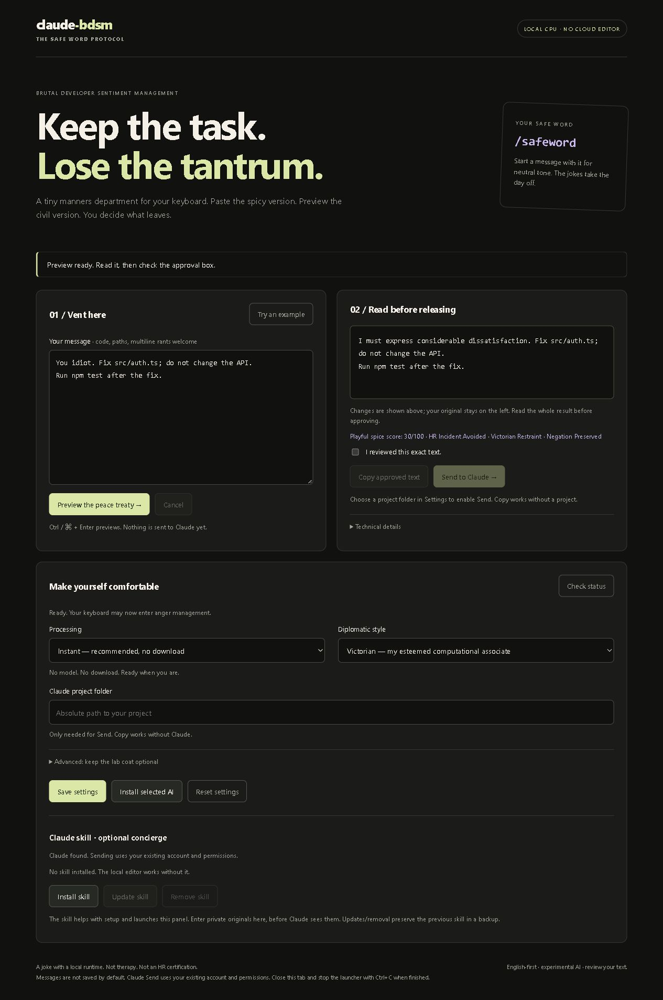

# claude-bdsm

**Brutal Developer Sentiment Management · The Safe Word Protocol**

Your code has bugs. Your prompt doesn't need a criminal record.

Give your keyboard a tiny manners department: paste the spicy version, preview the civil version, then decide what to copy or send to Claude.

```text
You idiot. Fix src/auth.ts; do not change the API.
                         ↓
I'm frustrated with the previous result. Fix src/auth.ts; do not change the API.
```

The insult gets a timeout. The task keeps its job.



## First date: setup

Bring **Node.js 22.16+ (22.x)** and Git. Claude Code is optional unless you want to send directly to Claude.

```sh
git clone https://github.com/nlomer/claude-bdsm.git
cd claude-bdsm
npm run setup
```

Setup installs locked development tools and builds the app. It offers the Claude skill and optional local AI; pressing Enter skips them. No GPU, Python, Ollama, cloud classifier or surprise subscription required.

Unattended setup: `npm run setup -- --yes` builds only—no global skill or model downloads. If a step fails, fix the reported issue and rerun setup. Your settings stay put. Windows x64 is tested; Linux x64 execution remains unverified.

## Open the manners department

```sh
npm start
```

Or **double-click `Start.cmd` on Windows** after setup. A local browser panel opens. Keep the launcher terminal running; Ctrl+C closes the app. Closing just the browser tab does not stop it.

1. **Paste** your message. Multiline rants and code are welcome.
2. **Preview** the peace treaty. Nothing has been sent to Claude.
3. **Read** the result and check “I reviewed this exact text.”
4. **Copy** it, or **Send to Claude** using the project folder chosen in Settings.

Your original stays beside the preview. Editing input/settings invalidates approval. Uncertain cases ask you to rewrite instead of confidently mangling your task. Expired preview? Make a fresh one.

Send uses your existing Claude account and permissions, with normal provider usage. It's a single turn with a readable reply, not a replacement Claude terminal. Cancelling an already-started send cannot unsend it.

## Settings, minus the JSON homework

Choose processing, style and Claude project once. The panel remembers them.

| Processing | What you're signing up for |
|---|---|
| **Instant — recommended** | No model download. Narrow rules. Extremely small manners department. |
| **Small local AI — experimental** | ~271 MB weights plus CPU runtime. For the adventurous minimalist. |
| **Larger local AI — experimental** | ~397 MB weights plus CPU runtime. More room for diplomatic incidents. |

Choosing a profile doesn't download anything. **Install selected AI** explains the download and asks first. Only that model is invited. Runtime adds about 24 MB to the download; installed memory/storage are larger than weight size.

AI choices are experiments: automatic scores don't establish preserved intent. Small AI is the smallest tested hybrid above the provisional coverage threshold. The 105 MB candidate added little beyond rules and isn't a beginner preset. See [measured results](BENCHMARK-RESULTS.md) if you enjoy spreadsheets more than rage.

Choose your diplomatic costume:

- **Neutral:** let's just fix the bug.
- **HR:** per my last emotional outburst.
- **Victorian:** my esteemed computational associate.

Styles affect narrowly validated emotional clauses, not your task. Start with **`/safeword`** for neutral tone and no jokes/awards. Rage scores are silly local heuristics, not therapy or HR certification.

Preview stays on. Private diagnostic retention stays off by default. Advanced settings are there when needed; nobody has to memorize a model ID to use the app.

## The Claude skill: your optional concierge

Install it during setup or in the panel. Then, in Claude Code:

```text
/claude-bdsm
```

Ask it to check setup, explain settings or launch the editor. Keep the clone at its installed location. **Update skill** backs up an owned installation before replacing it; **Remove skill** moves it to a backup. Custom files are preserved. No global hooks are installed automatically.

A skill cannot intercept a message before Claude reads it. Put private originals in the **local panel**, not into Claude followed by a magical “forget you saw that.” Magic is outside the dependency budget.

## Where does my tantrum go?

Editing runs locally on your CPU. Panel/model servers bind to loopback; no cloud editor fallback, hosted scripts or telemetry. Setup downloads need networking. **Send to Claude** is the explicit point where approved text goes to Claude.

Messages aren't saved by default. Preferences and aggregate counters live in this clone's ignored `.local/`. Opt-in diagnostics contain private text until you delete them. The tab holds messages in memory; same-user browser/process access and OS swap remain outside this boundary.

English-first, conservative, and occasionally confused. Quotes, intertwined instructions and unsupported languages may need your rewrite. It doesn't make conversations policy-proof, erase history or fix the bug for you. [Privacy details](PRIVACY.md).

## Updates, repairs and other adult responsibilities

Stop the launcher before updating:

```sh
git pull --ff-only
npm run setup
```

Reopen with `npm start`. **Check status** explains selected-model/Claude readiness. No Claude? Copy still works. Failed model verification? Reinstall the selected AI or choose Instant. An unrelated skill already exists? It stays untouched.

To remove: stop the launcher, remove its skill through the panel if installed, then remove this clone after saving anything you want. Skill backups live under the Claude config directory's `skill-backups/`. No automatic cleanup eats your customizations.

## For people who read footnotes

[Advanced CLI and hooks](docs/ADVANCED.md) · [Claude integration](INTEGRATION.md) · [Benchmark methodology](BENCHMARK.md) · [Measured results](BENCHMARK-RESULTS.md)

```sh
npm test
npm run test:integration
```

Tests use synthetic text, temporary profiles and fake downstream providers. Native tests skip without downloaded artifacts. Human model-fidelity review is pending; Linux/live-provider execution remains unverified.

## License

[MIT](LICENSE). Models/runtime keep their [upstream licenses](THIRD_PARTY_NOTICES.md). Manners sold separately. Actually, no: this whole thing is free.
